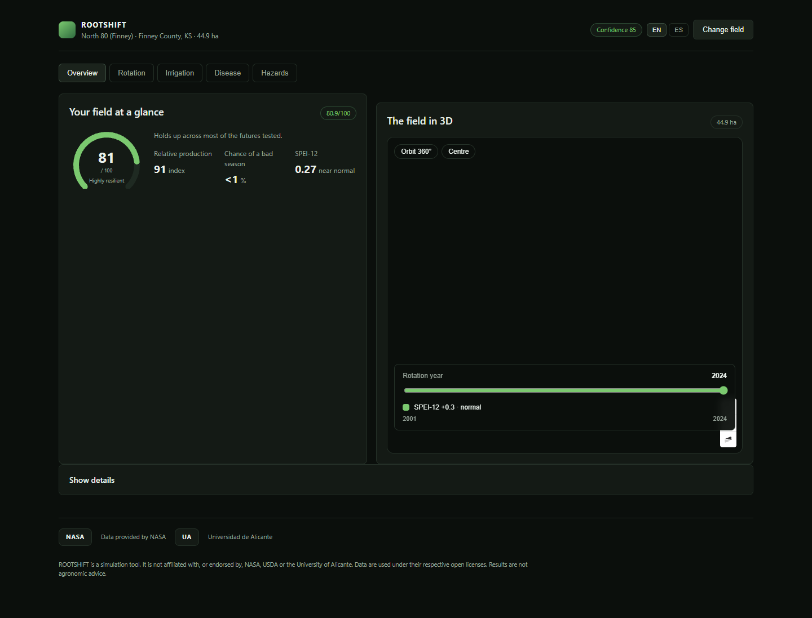
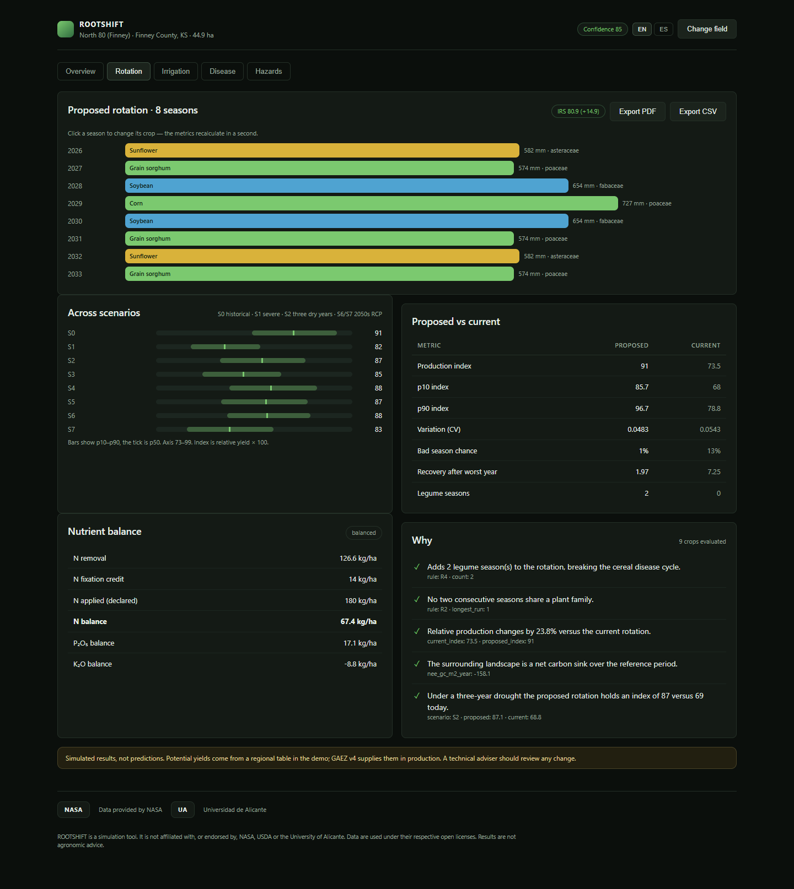
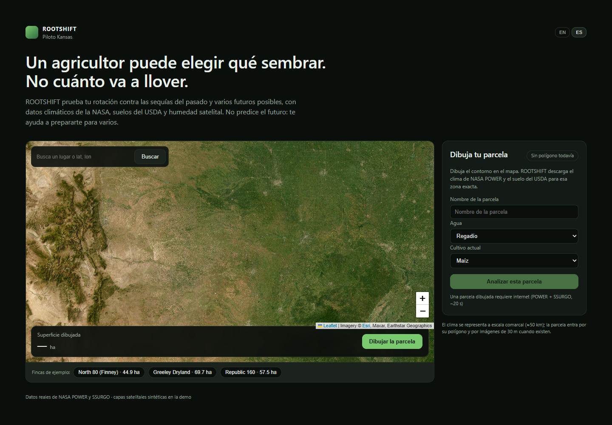

# ROOTSHIFT

**Test a crop rotation against the droughts of the past and several possible futures.**

ROOTSHIFT is a web application for the NASA hackathon. A farmer picks a field in Kansas, and the app
returns a rotation that holds up better under drought, heat and 2050s climate scenarios — with the
reasoning, the uncertainty and the data provenance attached to every number.

It does **not** predict the future. It simulates several of them.

---

## Quick start

Three ways to run it. None of them needs a PowerShell script.

### 1. Docker — nothing to install

```bash
docker compose up --build
```

Open <http://localhost:8000>. One image, one port, one process: the API also serves the built web app.
The SQLite data lives in a named volume, so `docker compose down` does not lose your farms.

### 2. Python only — no Node at runtime

Build the web app once (Node 20+), then everything runs from Python:

```bash
cd frontend && npm install && npm run build && cd ..
cd backend && python -m pip install -r requirements.txt
python -m rootshift
```

Open <http://127.0.0.1:8000>. `npm run build` writes plain static files to `frontend/out`, and the
Python process serves them at `/` next to the API. If you skip the build, the API still works
(`/docs`) and only the web UI is missing.

### 3. Development — two processes with hot reload

```bash
cd backend && python -m uvicorn rootshift.api.app:app --port 8000 --reload
cd frontend && npm run dev
```

Open <http://localhost:3000>. `frontend/.env.development` points the dev server at the API on port 8000.

---

Whichever you pick, the three Kansas demo fields simulate offline (`DATA_MODE=demo`, the default) and
the IMERG series ships in `data/fixtures/`.

The app has four screens:

1. **Map** — almost the whole page is a satellite map (Esri World Imagery). Draw the field with the
   pencil, delete it with the bin, search by place or `lat, lon`. The three demo fields are chips in the
   header. *Continue* appears once a polygon exists.
2. **Design** — pick the crops you want to plant (the ones recommended for the region are highlighted),
   your current crop and the water regime, then *Analyse*.
3. **Loading** — a spinner, nothing else.
4. **Results** — a five-section navbar (*Resumen, Rotación, Riego, Sanidad, Riesgos*). *Resumen* is a
   synthesised overview with the **3D parcel embedded**: the polygon on real elevation, coloured by the
   drought severity of each past year as you move the time bar.

The interface ships in **English and Spanish** (`EN` / `ES` in the header, persisted in the browser).
Not just the labels: findings, caveats, disease names and actions, hazard protocols and irrigation
equipment are localised too.

**Draw the field.** On the map, click the pencil, click the corners, close the polygon (or click the
first point): the area is computed geodesically and the vertices can be dragged afterwards. *Continue*
sends that exact polygon to the backend, which resolves its county, soil and climate and builds the
field (≈10 s the first time, cached afterwards; needs internet). The demo fields use preloaded data, so
they work offline.

**See it in 3D.** The 3D parcel lives inside *Resumen*: the polygon on satellite imagery over real
elevation (open DEM tiles), coloured by the drought severity of each past year. The only map controls
are *Orbit 360°* and *Centre*.

**Edit the rotation.** In the Rotation tab, click any season and pick another crop: the metrics, the
resilience index, the nutrient balance and the findings recalculate in about a second. Constraint
violations (same family, repeated species) appear as warnings but never block you, and *Restore
optimised* brings back the original design. That is the difference between a report and a simulator.

**It survives a restart.** Farms and rotations are written through to SQLite, so stopping the API and
starting it again keeps every field, its context and its report available.

Verify the stack:

```bash
cd backend
python -m pytest tests -q          # 107 tests: formulas, API contract, offline, imagery, i18n, reports, editing, persistence, IMERG, polygon fields
python scripts/e2e.py              # full API walkthrough for the 3 demo farms
python scripts/restart_check.py    # kills the API mid-run and proves the farm comes back
```

Browser check, against whichever server you started:

```bash
cd frontend
node tests/ui-check.mjs                                   # full flow + all tabs (single process on :8000)
WEB_URL=http://127.0.0.1:8080 node tests/ui-check.mjs     # Docker
node tests/flow-check.mjs                                 # map -> design -> 3D time bar
node tests/custom-field-check.mjs                         # draw a field and analyse it (needs internet)
```

### Proof that the demo runs offline

```powershell
# terminal 1: start the API with the provider layer blocked
$env:ROOTSHIFT_OFFLINE="1"; $env:DATA_MODE="demo"
python -m uvicorn rootshift.api.app:app --host 127.0.0.1 --port 8001

# terminal 2: run the whole flow against it
$env:API_BASE="http://127.0.0.1:8001/api/v1"; python backend/scripts/e2e.py
```

The provider layer raises on any network call in that mode, so a green run proves the demo path is
fixture-only.

### Screenshots

| | |
|---|---|
|  |  |
|  |  |
|  |  |

More in `docs/screenshots/` (landing map, disease, hazards, hazard protocol, custom field, Spanish views).
Sample exports: [report (ES)](docs/reports/rootshift-report-es.pdf) · [report (EN)](docs/reports/rootshift-report-en.pdf) ·
[CSV](docs/reports/rootshift-report-en.csv) · [page 1 rendered](docs/reports/report-es-page1.png).

---

## What is real and what is a fixture

| Layer | Source | Status |
|---|---|---|
| Daily weather 1991–2024 | **NASA POWER** (`/api/temporal/daily/point`, community AG) | **Real**, fetched live and cached |
| Monthly precipitation 2001–2024 | **GPM IMERG monthly** (`GPM_3IMERGM` v07) via Earthdata OPeNDAP | **Real**, precomputed into `data/fixtures/imerg_monthly.json` |
| Soil profile | **USDA SSURGO** (Soil Data Access, spatial query + `chorizon`) | **Real**, fetched live and cached |
| Time-map imagery | **NASA GIBS** (MODIS NDVI, true color, land surface temperature) | **Real**, served as PNG through the API and cached |
| **SQLite** store (`backend/data/cache/rootshift.sqlite3`) | **Real**: farms and rotations survive an API restart |
| Soil moisture, NDVI series, night LST, NPP/NEE, runoff, GAEZ multipliers, CoCoRaHS validation | Fixtures generated deterministically from the real weather and soil | **Synthetic**, labelled as such in the UI and in every provenance record |

The fixtures are rebuilt with:

```powershell
cd backend
python -m pipeline.build_fixtures      # POWER + SSURGO, no credentials needed
python -m pipeline.ingest_imerg        # GPM IMERG monthly, needs EARTHDATA_TOKEN
```

`build_fixtures` needs no credentials. `ingest_imerg` reads `EARTHDATA_TOKEN` from the environment or
from `backend/.env` (gitignored) and takes about a minute for 24 years.

The UI shows the *Confidence* chip and a caveat banner whenever synthetic fixtures are in play. With the
network unplugged the time map falls back to the modelled parcel view and says so, and the IMERG series
still loads because it ships in `data/fixtures/`.

---

## Architecture

```
frontend/            Next.js 15 + TypeScript, single-page app with 6 views
  app/page.tsx       landing, overview, rotation, disease, irrigation, time map, hazards
  components/        SVG charts (gauge, scenario bars, sparkline, parcel map)
  lib/api.ts         typed-ish client for the REST API
backend/
  rootshift/domain/  PURE functions: climate, water, drought, yield, rotation,
                     nutrients, resilience, disease, irrigation, hazards, erosion
  rootshift/providers/  POWER and SSURGO clients with disk cache (the only door to the internet)
  rootshift/services/   context builder + application services (F1–F5)
  rootshift/api/        FastAPI app (spec §11)
  data/catalog/         crops, diseases, nutrients, hazards, rotation effects, scoring, sources
  data/fixtures/        precomputed demo fields
  tests/                23 golden tests on the formulas
  pipeline/             fixture builder CLI
```

The rule that keeps it maintainable: **`domain/` never imports `providers/`, `services/` or FastAPI.**
Every formula is a pure function with a unit test.

---

## The calculation chain (short version)

1. **Context** (once per field): ET0 (FAO-56), water balance (FAO-56 bucket), SPI/SPEI (IMERG-shaped
   series), agricultural drought days from soil moisture, VCI, RUSLE factors, carbon balance.
2. **Yield**: FAO-33 water-limited ratio × heat factor × frost factor × rotation effect, against an
   attainable yield (GAEZ in production, a regional table in the demo).
3. **Scenarios**: S0 historical bootstrap, S1 severe drought, S2 three dry years, S3 heat at
   flowering, S4 extreme rainfall, S5 late frost, S6/S7 GAEZ 2050s RCP4.5 / RCP8.5.
   One thousand members each, common random numbers across candidates.
4. **Rotation**: beam search over sequences → Monte Carlo evaluation of the best 20 → local search.
5. **Resilience index**: six sub-indices (water, stability, soil, diversity, disease, hazard), every
   contribution shown in the UI.

---

## API (main routes)

| Method | Route | Purpose |
|---|---|---|
| `GET` | `/api/v1/meta/region` | Region, crops and demo fields |
| `POST` | `/api/v1/farms` | Create a farm from a demo field |
| `GET` | `/api/v1/farms/{id}/context` | Climate, soil, drought, water, carbon, erosion |
| `POST` | `/api/v1/farms/{id}/rotation:optimize` | Job → rotation result, scenarios, IRS, nutrients |
| `PUT` | `/api/v1/farms/{id}/rotations/{rid}` | Edit the sequence and recompute |
| `GET` | `/api/v1/farms/{id}/diseases` | Disease risk per crop |
| `POST` | `/api/v1/farms/{id}/irrigation` | System, flow, zones, schedule, materials |
| `GET` | `/api/v1/farms/{id}/hazards` | Hazard probabilities + action protocols |
| `GET` | `/api/v1/farms/{id}/timeline?layer=` | Monthly series for the time map |
| `GET` | `/api/v1/imagery?layer=&date=&bbox=` | Real NASA GIBS image (PNG) for the field |
| `GET` | `/api/v1/imagery/layers` | Available imagery layers |
| `GET` | `/api/v1/farms/{id}/report.pdf` | Printable two-page report (locale-aware) |
| `GET` | `/api/v1/farms/{id}/report.csv` | Same data as CSV, UTF-8 with BOM |
| `GET` | `/api/v1/jobs/{id}` | Job status/result |

OpenAPI is served at <http://127.0.0.1:8000/docs>.

---

## Known limitations (read this before the demo)

- **Scale.** Climate is county-scale (POWER 0.5°, IMERG 0.1°). The field enters through its boundary
  and through 30 m layers, not through the climate grid.
- **Synthetic satellite layers.** Soil moisture, NDVI, LST, carbon, runoff and GAEZ multipliers are
  fixtures in the demo. The provenance says so.
- **No spatial database yet.** The MVP keeps farms in memory and writes series to Parquet/JSON.
  PostGIS is in the spec, not in this build.
- **Maps are SVG.** The parcel and zone views are rendered in SVG from GeoJSON; MapLibre and TiTiler
  are the production path.
- **Disease risk is climate favour-ability**, not a diagnosis, and the thresholds are preliminary.
- **No prescriptions.** No products, no rates, no prices, no economic advice.

See `IMPLEMENTATION_NOTES.md` for the deviations from the specification and why.

---

## Attribution

Data provided by NASA (POWER, and the SMAP/MODIS/IMERG/GLDAS/GAEZ chain in production) and USDA-NRCS
(SSURGO). Universidad de Alicante.

ROOTSHIFT is a simulation tool. It is not affiliated with, or endorsed by, NASA, USDA or the
University of Alicante. Data are used under their respective open licenses. Results are not
agronomic advice.
