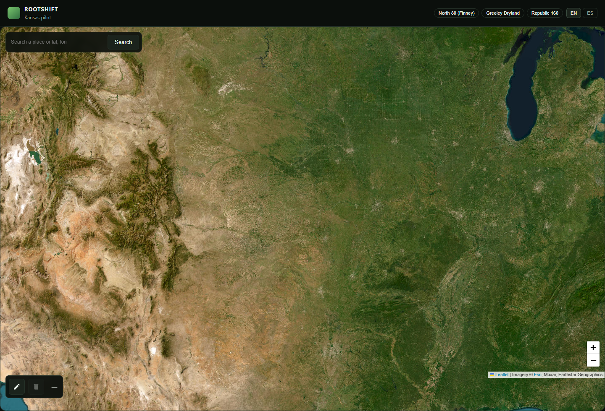
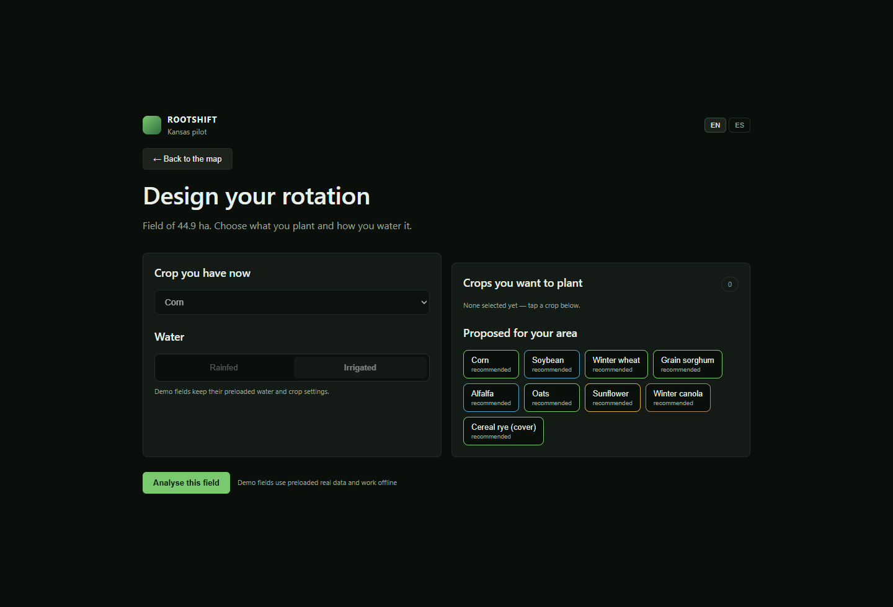
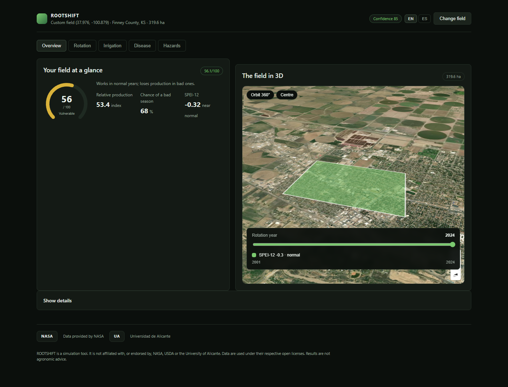

# ROOTSHIFT

**Test a crop rotation against the droughts of the past and several possible futures.**

ROOTSHIFT is a web application built for a NASA hackathon. A farmer picks a field in Kansas, and the app returns a rotation that holds up better under drought, heat and 2050s climate scenarios, with the reasoning, the uncertainty and the data provenance attached to every number.

It does **not** predict the future. It simulates several of them.

---

## Quick start

There are three ways to run it. The commands below use bash. In Windows PowerShell, set environment variables with `$env:NAME="value"` instead of `NAME=value`.

### 1. Docker (no local dependencies)

```bash
docker compose up --build
```

Open <http://localhost:8000>. The image serves one port and one process: the API also serves the built web app. The SQLite data lives in a named volume, so `docker compose down` does not delete your farms.

### 2. Python only (Node is needed only to build the web app)

Build the web app once with Node 20+, then run everything from Python:

```bash
cd frontend && npm install && npm run build && cd ..
cd backend && python -m pip install -r requirements.txt
python -m rootshift
```

Open <http://127.0.0.1:8000>. `npm run build` writes static files to `frontend/out`, and the Python process serves them at `/`, next to the API. If you skip the build, the API still works at `/docs`, but the web UI is missing.

### 3. Development (two processes with hot reload)

In one terminal:

```bash
cd backend
python -m uvicorn rootshift.api.app:app --port 8000 --reload
```

In another terminal:

```bash
cd frontend
npm run dev
```

Open <http://localhost:3000>. `frontend/.env.development` points the dev server at the API on port 8000.

Whichever option you choose, the three Kansas demo fields run offline (`DATA_MODE=demo`, the default), and the IMERG series ships in `data/fixtures/`.

---

## Using the app

The app has four screens:

1. **Map.** A satellite map (Esri World Imagery). Draw the field with the pencil, delete it with the trash icon, or search by place name or `lat, lon`. The three demo fields are chips in the header. *Continue* appears once a polygon exists.
2. **Design.** Pick the crops you want to plant (the crops recommended for the region are highlighted), your current crop and your water regime, then click *Analyze*.
3. **Loading.** A spinner while the simulation runs.
4. **Results.** A five-section navbar: *Resumen*, *Rotación*, *Riego*, *Sanidad* and *Riesgos* (Overview, Rotation, Irrigation, Disease and Hazards in English). *Resumen* is a synthesized overview with the **3D parcel**: the polygon on real elevation, colored by the drought severity of each past year as you move the time bar.

The interface ships in **English and Spanish**. Switch with `EN` / `ES` in the header; the choice is saved in the browser. Findings, caveats, disease names, actions, hazard protocols and irrigation equipment are localized too, not only the labels.

**Draw the field.** On the map, click the pencil, click the corners, and close the polygon by clicking the first point again. The area is computed geodesically, and you can drag the vertices afterwards. *Continue* sends that exact polygon to the backend, which resolves its county, soil and climate and builds the field. The first build takes about 10 seconds and is cached afterwards; it needs internet access. The demo fields use preloaded data and work offline.

**See it in 3D.** The 3D parcel is in *Resumen*: the polygon on satellite imagery over real elevation (open DEM tiles), colored by the drought severity of each past year. The only map controls are *Orbit 360°* and *Center*.

**Edit the rotation.** In the Rotation tab, click any season and choose another crop. The metrics, resilience index, nutrient balance and findings recalculate in about a second. Constraint violations (same family, repeated species) appear as warnings and never block you. *Restore optimized* brings back the original design. That is the difference between a report and a simulator.

**It survives a restart.** Farms and rotations are saved to SQLite. Stop the API and start it again, and every field, its context and its report are still there.

---

## Verify the stack

```bash
cd backend
python -m pytest tests -q          # formulas, API contract, offline mode, imagery, i18n, reports, editing, persistence, IMERG, polygon fields
python scripts/e2e.py              # full API walkthrough for the three demo farms
python scripts/restart_check.py    # stops the API mid-run and checks that the farm comes back
```

Browser checks, against whichever server you started:

```bash
cd frontend
node tests/ui-check.mjs                                  # full flow and all tabs (single process on :8000)
WEB_URL=http://127.0.0.1:8080 node tests/ui-check.mjs    # Docker
node tests/flow-check.mjs                                # map → design → 3D time bar
node tests/custom-field-check.mjs                        # draw a field and analyze it (needs internet)
```

### Check that the demo runs offline

The provider layer raises an error on any network call in this mode, so a passing run shows that the demo path uses only fixtures.

Terminal 1, from `backend/`:

```bash
ROOTSHIFT_OFFLINE=1 DATA_MODE=demo python -m uvicorn rootshift.api.app:app --host 127.0.0.1 --port 8001
```

Terminal 2, from the project root:

```bash
API_BASE=http://127.0.0.1:8001/api/v1 python backend/scripts/e2e.py
```

---

## Screenshots

| | |
|---|---|
|  |  |
|  |  |
|  |  |

More are in `docs/screenshots/`: landing map, disease, hazards, hazard protocol, custom field and Spanish views.

Sample exports: [report (ES)](docs/reports/rootshift-report-es.pdf) · [report (EN)](docs/reports/rootshift-report-en.pdf) · [CSV](docs/reports/rootshift-report-en.csv) · [page 1 rendered](docs/reports/report-es-page1.png).

---

## Data: what is real and what is a fixture

| Layer | Source | Status |
|---|---|---|
| Daily weather, 1991–2024 | **NASA POWER** (`/api/temporal/daily/point`, community AG) | **Real**, fetched live and cached |
| Monthly precipitation, 2001–2024 | **GPM IMERG monthly** (`GPM_3IMERGM` v07) via Earthdata OPeNDAP | **Real**, precomputed into `data/fixtures/imerg_monthly.json` |
| Soil profile | **USDA SSURGO** (Soil Data Access, spatial query + `chorizon`) | **Real**, fetched live and cached |
| Time-map imagery | **NASA GIBS** (MODIS NDVI, true color, land surface temperature) | **Real**, served as PNG through the API and cached |
| Farms and rotations | **SQLite** store (`backend/data/cache/rootshift.sqlite3`) | **Real**, survives an API restart |
| Soil moisture, NDVI series, night LST, NPP/NEE, runoff, GAEZ multipliers, CoCoRaHS validation | Fixtures generated deterministically from the real weather and soil data | **Synthetic**, labeled as such in the UI and in every provenance record |

The fixtures are rebuilt with:

```bash
cd backend
python -m pipeline.build_fixtures      # POWER + SSURGO, no credentials needed
python -m pipeline.ingest_imerg        # GPM IMERG monthly, needs EARTHDATA_TOKEN
```

`build_fixtures` needs no credentials. `ingest_imerg` reads `EARTHDATA_TOKEN` from the environment or from `backend/.env` (gitignored). It takes about a minute for 24 years of data.

The UI shows the *Confidence* chip and a caveat banner whenever synthetic fixtures are in use. With the network unplugged, the time map falls back to the modeled parcel view and says so. The IMERG series still loads, because it ships in `data/fixtures/`.

---

## Architecture

```
frontend/            Next.js 15 + TypeScript single-page app
  app/page.tsx       landing, overview, rotation, disease, irrigation, time map, hazards
  components/        SVG charts (gauge, scenario bars, sparkline, parcel map)
  lib/api.ts         typed-ish client for the REST API
backend/
  rootshift/domain/  PURE functions: climate, water, drought, yield, rotation,
                     nutrients, resilience, disease, irrigation, hazards, erosion
  rootshift/providers/  POWER and SSURGO clients with disk cache (the only door to the internet)
  rootshift/services/   context builder and application services (F1–F5)
  rootshift/api/        FastAPI app
  data/catalog/         crops, diseases, nutrients, hazards, rotation effects, scoring, sources
  data/fixtures/        precomputed demo fields
  tests/                golden tests on the formulas, plus API and workflow tests
  pipeline/             fixture builder CLI
```

The rule that keeps it maintainable: **`domain/` never imports `providers/`, `services/` or FastAPI.** Every formula is a pure function with a unit test.

---

## The calculation chain

1. **Context** (once per field): ET0 (FAO-56), water balance (FAO-56 bucket), SPI/SPEI (IMERG-shaped series), agricultural drought days from soil moisture, VCI, RUSLE factors and carbon balance.
2. **Yield**: FAO-33 water-limited ratio × heat factor × frost factor × rotation effect, against an attainable yield (GAEZ in production, a regional table in the demo).
3. **Scenarios**: S0 historical bootstrap, S1 severe drought, S2 three dry years, S3 heat at flowering, S4 extreme rainfall, S5 late frost, S6/S7 GAEZ 2050s under RCP4.5 and RCP8.5. Each has 1,000 members, with common random numbers across candidates.
4. **Rotation**: beam search over sequences, then Monte Carlo evaluation of the best 20, then local search.
5. **Resilience index**: six sub-indices (water, stability, soil, diversity, disease, hazard). Every contribution is shown in the UI.

---

## API (main routes)

| Method | Route | Purpose |
|---|---|---|
| `GET` | `/api/v1/meta/region` | Region, crops and demo fields |
| `POST` | `/api/v1/farms` | Create a farm from a demo field |
| `GET` | `/api/v1/farms/{id}/context` | Climate, soil, drought, water, carbon, erosion |
| `POST` | `/api/v1/farms/{id}/rotation:optimize` | Job → rotation result, scenarios, IRS, nutrients |
| `PUT` | `/api/v1/farms/{id}/rotations/{rid}` | Edit the sequence and recompute |
| `GET` | `/api/v1/farms/{id}/diseases` | Disease risk per crop |
| `POST` | `/api/v1/farms/{id}/irrigation` | System, flow, zones, schedule, materials |
| `GET` | `/api/v1/farms/{id}/hazards` | Hazard probabilities and action protocols |
| `GET` | `/api/v1/farms/{id}/timeline?layer=` | Monthly series for the time map |
| `GET` | `/api/v1/imagery?layer=&date=&bbox=` | NASA GIBS image (PNG) for the field |
| `GET` | `/api/v1/imagery/layers` | Available imagery layers |
| `GET` | `/api/v1/farms/{id}/report.pdf` | Printable two-page report (locale-aware) |
| `GET` | `/api/v1/farms/{id}/report.csv` | Same data as CSV, UTF-8 with BOM |
| `GET` | `/api/v1/jobs/{id}` | Job status and result |

OpenAPI is served at <http://127.0.0.1:8000/docs>.

---

## Known limitations

- **Scale.** Climate is county-scale (POWER 0.5°, IMERG 0.1°). Your field enters through its boundary and through 30 m layers, not through the climate grid.
- **Synthetic satellite layers.** Soil moisture, NDVI, LST, carbon, runoff and GAEZ multipliers are fixtures in the demo. The provenance records say so.
- **Storage.** Farms and rotations are stored in SQLite. A spatial database (PostGIS) is planned but is not part of this build.
- **Maps.** The 2D parcel and zone views are SVG rendered from GeoJSON. MapLibre and TiTiler are the planned production path.
- **Disease risk is climate favorability**, not a diagnosis. The thresholds are preliminary.
- **No prescriptions.** No products, rates, prices or economic advice.

See `IMPLEMENTATION_NOTES.md` for where the build differs from the original design.

---

## Data sources and attribution

- **NASA POWER** (daily weather), **NASA GPM IMERG** (precipitation) and **NASA GIBS** (MODIS imagery): real data in the demo.
- **USDA-NRCS SSURGO** (soil profile, via Soil Data Access): real data in the demo.
- **FAO GAEZ v4**: planned for the production data chain.
- **Esri World Imagery**: satellite basemap on the map screen. See the attribution shown on the map.
- **Open DEM tiles**: elevation for the 3D view.
- **Universidad de Alicante.**
- Soil moisture, NDVI, LST, carbon, runoff and GAEZ values in the demo are **synthetic**. They are generated from the real weather and soil data and are labeled as synthetic in the app.

Data provided by NASA.

ROOTSHIFT is a simulation tool. It is not affiliated with, or endorsed by, NASA, USDA or the University of Alicante. Data are used under their respective open licenses. Results are not agronomic advice.

---

## License

The code is released under the MIT License. See [LICENSE](LICENSE).
